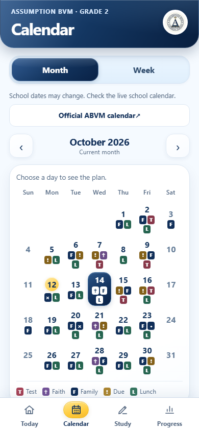
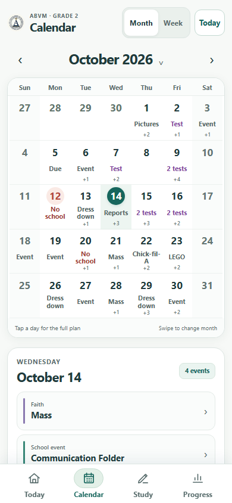

# Calendar reimagined — month-focused review

The owner requested a complete Calendar redesign and then clarified that separate year-switching controls are unnecessary. This implementation retains previous/next month, a twelve-month picker and Today. December/January rollover remains ordinary month navigation.

## Actual rendered comparison

These are browser screenshots of application code, not generated mockups. Baseline: main `0f34105d9e88183e37c3a468905e3f4ce9fabb2d`. Both versions use the same October 12, 2026 clock and October 14 selection. The screenshots contain only existing published school information.

| Before — 390px phone | After — 390px phone |
| --- | --- |
|  |  |

[Before desktop](before-1440.png) · [After desktop](after-1440.png)

## Interface

Compact school identity; white/warm-gray surfaces and teal selection; distinct coral Today indicator; complete week rows with adjacent dates; meaningful text summaries rather than letter-coded markers; full source-backed event details; existing verified lunch text and artwork; direct month selection, swipe and keyboard navigation. The selected agenda appears below the month on phones and beside it on desktop. Secondary school information and the official calendar link remain available.

No separate year picker or year increment/decrement controls are included.

## Data and release boundaries

No school sources, dates, teacher-check timestamps, approved school photos, learning records, importer schedules, notifications, protected baseline styles or source-resolution rules are changed. Calendar rendering is moved into the existing presentation layer. Civil-date navigation avoids UTC parsing and clamps month ends correctly. Existing offline shell versions are synchronized; its caching logic is unchanged.

This branch is added to the existing read-only, fail-closed source-parity comparison. Existing full QA, independent reproduction and exact-main Pages release gates are retained. PR workflow results on the exact current commit are the authority for release readiness; local previews and screenshots are not proof of deployment.

## Verification recorded before submission

- New date/grid/source-escaping/parity unit tests: 9 passed, after first observing their expected failures.
- Focused Chromium/iPhone-WebKit visual and interaction run: 47 passed, 1 explicitly scoped skip, 0 failures. Coverage includes 320/375/390/430/820/1440px, enlarged text, accessibility/contrast, focus, swipes, busy and empty days, leap February, year-boundary month stepping, cross-timezone/DST dates, source disclosure and bottom-navigation clearance.
- Static validation: passed.
- Local whole-unit run on Windows exposed two POSIX-only release-admission tests that require the Linux CI environment. They are unchanged and must pass remotely.
- Playwright documents service-worker testing as Chromium-only: https://playwright.dev/docs/service-workers. New cold offline reload is verified in Chromium; separately named in-session offline navigation runs on Chromium and WebKit. Existing offline tests remain intact. Physical iPhone Safari testing is not claimed.

Only obsolete presentation selectors were updated in existing browser tests. Full event titles, date authority, meal content/artwork, source proofs, touch targets, focus and overflow assertions remain enforced.
